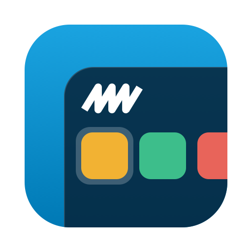
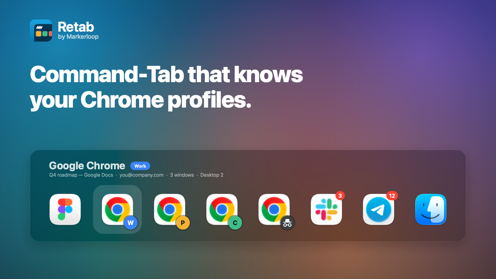

# Retab

**Command-Tab, with every Chrome profile as its own icon.** A small, free, open-source Mac app that replaces the system's app switcher with one that looks and works the same — a row of icons, hold the keys, let go to switch — except that a browser with several profiles shows one icon per profile, with the account's picture and the profile's colour.



*Retab*: Tab, done again. Made by [Markerloop](https://markerloop.com).

Free to use, open source, MIT.

> **Early alpha.** Retab is new and has been used on one Mac (macOS 26, Google Chrome in English). It is not signed with an Apple Developer ID. Expect rough edges and tell us about them.

## Why

Three Chrome windows from three profiles are one icon in Command-Tab. You switch to "Chrome" and land in whichever window was used last — often not the one you are looking at, on the other monitor — and close a tab in the wrong account. Retab makes each profile a place you can switch to by itself.

## How it works

- **Hold Command, press Tab.** A panel shows one icon per app, and one per browser profile. Let go to switch.
- **Shift-Tab and the arrow keys** move around; **Escape** cancels; the mouse works too.
- **A quick tap** switches to the app or profile used before this one, without the panel.
- **Drop on an icon.** Drag a file or a link, press Command-Tab on the way and drop it on an icon: it opens in that app. Dropped on a Chrome profile, it opens in that profile. Let go of Command over an icon instead, and Retab switches to it with the drag still in hand.
- Above the icons, a title and a subtitle say where the selected icon leads: the window's title, the profile's account, how many windows there are, whether it is minimised or full screen, and which desktop it is on.
- The red numbers apps put on their Dock icons — unread messages — are on the icons here too.
- For Music and Spotify the subtitle shows what is playing, from the next track change on.

Retab uses the shortcut your Mac already uses for switching apps, whatever it is set to, and steps in for the system's switcher while it runs. Quit Retab and the system's switcher is back.

### Chrome profiles

Chrome writes the profile into each window's title; Retab reads it and looks the profile up in Chrome's own settings for the account, its picture and the colour you gave the profile. Two profiles with the same name get the very same title, and Retab does not look at the windows themselves, so those two are one icon, without a picture. Rename one of them in Chrome and they are two.

Changes you make in Chrome — a new colour, a new picture, a renamed profile — show up within a minute.

Incognito and guest windows have an icon of their own, with a dark disc — the incognito figure or a person — and say so in the subtitle. Chrome doesn't tell which profile an incognito window came from, so all of them share that one icon. The mode is recognised from the English words; in other languages every private window is shown as incognito.

## It does not listen to your keyboard

Retab asks the system for a handful of shortcuts, the way any app gets a global shortcut, and the system calls it when one is pressed. No key press passes through Retab, and it cannot delay or lose one. The extra shortcuts for moving around the panel exist only while the panel is up.

It never looks at your screen either: Retab takes no pictures of windows and does not ask for Screen Recording. Everything it shows comes from what apps tell the system's accessibility and from Chrome's settings file.

Nothing leaves your Mac: there is no network code in Retab at all. It keeps a small log of what it did in `~/Library/Logs/Retab.log`; window titles are never written there.

## Requirements

| | |
|---|---|
| macOS | 14 Sonoma or newer. Used so far only on macOS 26. |
| Browser | Google Chrome for profile pictures and colours. Other Chromium browsers get one icon per profile, with a letter instead of a picture. |
| Permissions | Accessibility only — to read window titles and to bring one particular window forward. |
| To build | Xcode Command Line Tools |

## Build

```sh
git clone https://github.com/Markerloop-Team/retab.git
cd retab
./build.sh
open Retab.app
```

The build is one `clang` call over one file, `Sources/main.m`.

macOS ties permissions to an app's signature, and a plain build gets a new one every time, so the permissions would have to be granted again after each build. `tools/make_cert.sh` makes a local signing certificate once, in a small keychain of its own; with it every build is the same app to macOS, and nothing ever asks for a password.

## What it cannot do yet

- **Only Google Chrome is known by name.** Chrome Beta, Arc, Safari and Firefox profiles are not recognised.
- **Profiles with the same name are one icon** (see above).
- **Windows on other desktops can be late.** Without looking at the screen, Retab finds them through accessibility, which takes a moment; such a window may first appear on the second switch.
- **It is not the system's switcher.** The system's own Command-Tab cannot be extended, so Retab draws its own panel and switches the system's off while it runs. It does this, lists windows on other desktops and brings a single window forward through calls macOS does not document — the same ones every window switcher on the Mac relies on. A macOS update can break them, and the Mac App Store does not allow them.
- **Apps without a window are not shown.** `defaults write app.retab.mac showWindowless -bool YES` brings them back.
- **English only.**

## For debugging

- `Retab.app/Contents/MacOS/Retab --list` prints the windows Retab would offer.
- `Retab.app/Contents/MacOS/Retab --show` puts the panel of the running Retab up for two seconds, without touching the keyboard; how it went is in the log.
- `Retab.app/Contents/MacOS/Retab --demo picture.png` shows the panel once, saves a picture of it and quits; it touches no shortcut and needs no permission.
- **Copy Diagnostics** in the menu puts what Retab sees on the clipboard. It includes window titles, so read it before you paste it anywhere.

## Testing

There are no automated tests yet; [TESTING.md](TESTING.md) is the list to go through by hand before a release, with what has been checked on which Mac.

## Licence

MIT. See [LICENSE](LICENSE).
